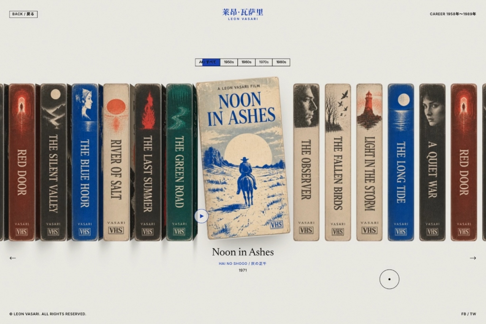
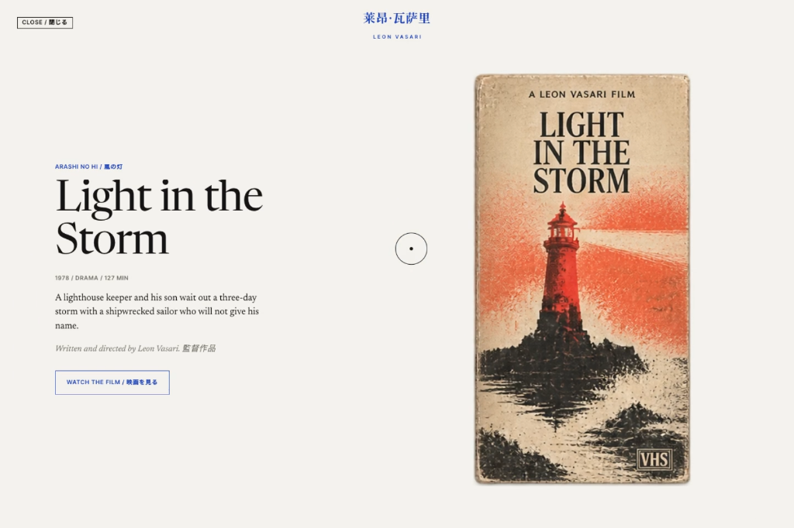

# 📼 Leon Vasari — Filmography Hero (1958–1989)

An archival, single-screen **interactive 3D filmography hero** for fictional Japanese auteur director **Leon Vasari (1958–1989)**. Built with **100% vanilla HTML5, CSS3 3D Transforms, and ES6+ JavaScript** — crafted with zero external libraries, zero frameworks, and zero build tools.

[](https://leon-vasari-filmography.vercel.app)
[](https://github.com/aanasmahfouz/leon-vasari-filmography)
[](./index.html)

---

## 📽️ Visual Showcase

### 1. The Endless 3D VHS Shelf Hero
The centerpiece is a continuous shelf of weathered VHS cassette boxes standing side by side. As you scroll, drag, or switch decades, the shelf slides with fluid spring physics. The active film tape pulls out forward, tilting toward the viewer and physically rotating 90° in true 3D space to reveal its illustrated cover art.



### 2. Ink-Bleed Detail Sheet View
Clicking the active tape cover, pressing **Enter**, or clicking the circular play trigger expands the sheet outward from the exact projected 3D coordinates of the physical cassette box. A bespoke SVG turbulence fractal filter bleeds raw ink into the poster artwork across 7 procedural organic nodes while masked typography slides upward.



---

## ✨ Features

- **True 3D Physical Cassettes**: Rendered using CSS `perspective: 2200px` and nested `transform-style: preserve-3d`. Each tape features a detailed spine face and illustrated cover face with real-time dynamic shading and realistic box shadows.
- **Continuous 36-Tape Virtual Loop**: Seamless 36-slot endless carousel with toroidal coordinate normalization, preventing edge snapping or scroll limits.
- **Physics-Based Spring Motion**:
  - Exponential spring smoothing ($k = 5.2$ during idle transitions, $k = 18$ during direct pointer drag).
  - Smoothstep ($S(x) = x^2(3 - 2x)$) for non-linear rotation and scale dampening.
  - Interactive mouse parallax tilting: the active cover subtly pitches and yaws toward the cursor.
- **Bespoke SVG Ink Bleed Animation**:
  - Procedural `<feTurbulence>` fractal noise and `<feDisplacementMap>` ink bleed simulation.
  - Staggered expansion of 7 procedural ink blobs mimicking vintage risograph and print press ink saturation.
- **Masked Typography Transitions**:
  - Web Animations API (`Element.animate`) staggered entry for titles, metadata, and synopses.
  - Zero opacity fades — pure physical directional sliding through masked clipping containers.
- **Context-Aware Dynamic Cursor**:
  - Smooth physics interpolation following the mouse pointer.
  - Morphing states: Dot, Spine Lift, Control Button Magnet, and **OPEN / FILM** callout.
- **Full Decade Filtering**: Synchronized tabs for **All Films**, **1950s**, **1960s**, **1970s**, and **1980s** with sliding pill indicator.
- **Responsive Architecture**: Fluid scaling via viewport math (`--H: min(46vh, 31vw)`) adapting seamlessly from 4K cinema displays to mobile handhelds.

---

## 🕹️ Controls & Navigation

| Action | Control Method |
| :--- | :--- |
| **Browse / Slide Shelf** | Drag shelf horizontally, Mouse Wheel / Trackpad scroll, Left/Right Arrow keys, or Navigation Arrows (`←` / `→`) |
| **Select Film** | Click any visible VHS spine |
| **Jump to Decade** | Click decade tabs (**ALL**, **1950s**, **1960s**, **1970s**, **1980s**) |
| **Open Film Detail** | Click active tape cover, click anywhere when **OPEN / FILM** cursor shows, click `▷` play button, or press `Enter` |
| **Close Detail View** | Click **CLOSE** button, press `Escape`, or click outside |

---

## 🎞️ Complete Filmography (1958–1989)

| # | Year | Title | Japanese / Genre | Duration |
| :-: | :--: | :--- | :--- | :-: |
| 01 | 1958 | **The Silent Valley** | *Shizuka na Tani* / Drama | 104 min |
| 02 | 1962 | **The Blue Hour** | *Aoi Jikan* / Mystery | 118 min |
| 03 | 1965 | **River of Salt** | *Shio no Kawa* / Period | 131 min |
| 04 | 1968 | **The Last Summer** | *Saigo no Natsu* / Romance | 98 min |
| 05 | 1969 | **The Green Road** | *Midori no Michi* / Road Movie | 112 min |
| 06 | 1971 | **Noon in Ashes** | *Hai no Shogo* / Western | 124 min |
| 07 | 1974 | **The Observer** | *Kansokusha* / Thriller | 109 min |
| 08 | 1976 | **The Fallen Birds** | *Ochita Tori* / Noir | 115 min |
| 09 | 1978 | **Light in the Storm** | *Arashi no Hi* / Drama | 127 min |
| 10 | 1981 | **The Long Tide** | *Nagai Shio* / Melodrama | 142 min |
| 11 | 1985 | **A Quiet War** | *Shizuka na Senso* / War | 136 min |
| 12 | 1989 | **Red Door** | *Akai To* / Psychological | 121 min |

---

## 📐 Mathematical Model & Physics

The horizontal placement of each cassette along the shelf uses an analytical displacement formula to create natural spacing around the pulled-out active box:

$$F(r) = r \cdot (w_s + \text{gap}) + \big(d - w_s + 1.6 \cdot \text{gap}\big) \cdot B(r)$$

Where:
- $r = (v - s) \pmod{36}$ is the signed distance from the active slot.
- $w_s$ is the tape spine width.
- $d$ is the cover depth ($0.526 \times H$).
- $B(r)$ is a smoothed step function defined by:

$$B(r) = \begin{cases} \frac{1}{2}\left(r + \frac{\sin(\pi r)}{\pi}\right) & \text{if } |r| < 1 \\ \frac{1}{2} \operatorname{sgn}(r) & \text{if } |r| \ge 1 \end{cases}$$

This guarantees smooth $C^1$ continuity during drag and continuous rotation without jarring leaps or overlapping boxes.

---

## 🚀 Getting Started

Clone the repository and open `index.html` directly in any modern browser:

```bash
# Clone the repository
git clone https://github.com/aanasmahfouz/leon-vasari-filmography.git

# Navigate to the folder
cd leon-vasari-filmography

# Run locally with any static server (or double-click index.html)
python -m http.server 8000
# or
npx serve .
```

Visit `http://localhost:8000` in your browser.

---

## 📜 License & Credits

Created by **[Anas Mahfouz](https://github.com/aanasmahfouz)**.  
Typography: *Newsreader* by Production Type & *Inter Tight* by Rasmus Andersson.  
Art Direction inspired by vintage 1970s Japanese cinema archives and analog magnetic tape packaging.
